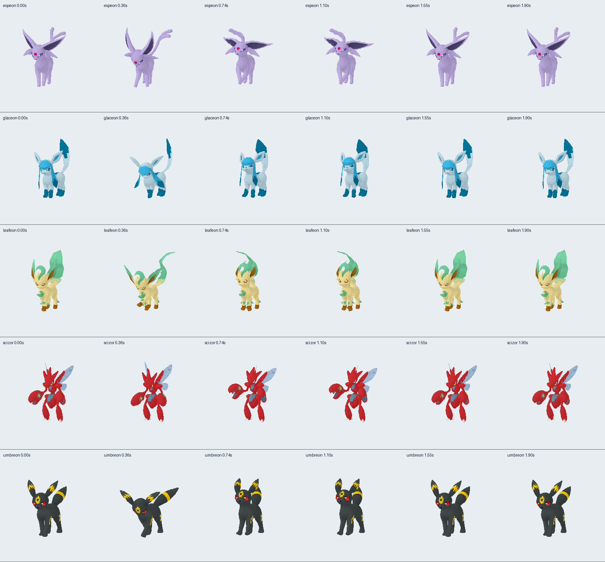

# Ensemble skeletal animation audit

Date: 2026-10-27. All 50 artwork species now have a skinned 3D model with mapped idle, entrance and attack clips. The distinction between native and project-authored animation is explicit in the manifest and provenance.

## What changed

- Restored 27 native entrance clips by appending the archived animation accessor bytes. Charizard already had its native `happy` clip and its GLB remains byte-identical to the pre-pass file. All 28 existing native attacks, including Charizard’s calibrated upright celebration, are unchanged.
- Added `ensemble_enter` and `ensemble_attack` to Espeon, Glaceon, Leafeon, Scizor and Umbreon. These use their actual 3D skeletons, with independent anatomical rotations, 60 Hz eased quaternion samples, secondary appendage motion, zero root motion, and a return to the original idle pose. They are project-authored choreography, not recovered official attacks.
- Integrated the separate 17-species acquisition/authoring pass. Twelve models use existing source skins; Cleffa, Forretress, Suicune, Breloom and Cinderace use documented anatomical skin transfers. See [the acquisition audit](remaining-species-assets.md) and its [complete fragment](remaining-species-assets.json).
- Added 19 measured effect cue entries for the original roster. All 14 earlier timing/socket records remain exactly identical apart from their updated GLB hashes. Total cue coverage is now 50.

No original body geometry, texture, material, node, skin, or retained animation changed in the original 33 models. Native entrance arrays are exact copies of archived source data. Added actions are genuine bone-driven skin deformation; no illustration bending is used.

## Entrance metadata

`enter` is the clip name. `enterStart` and `enterEnd` are source clip seconds. `enterSpeed` is playback rate. `entranceDuration = (enterEnd - enterStart) / enterSpeed` is wall time. `entranceAuthorship` is `native` or `project-authored`. The original 33 also include measured `entranceBounds`; the runtime must frame the complete entrance and action interval.

| Species | Entrance | Source interval | Speed | Wall seconds |
|---|---|---:|---:|---:|
| Aerodactyl | wingbeat salute | 0.000–0.950 | 1.20 | 0.792 |
| Alakazam | raised-spoon salute | 0.200–1.200 | 1.20 | 0.833 |
| Articuno | bow into wing fan | 0.550–2.100 | 1.80 | 0.861 |
| Blastoise | planted arm salute | 0.650–2.200 | 1.80 | 0.861 |
| Charizard | wing anticipation | 0.000–0.900 | 1.20 | 0.750 |
| Dracozolt | upright roar | 0.250–1.300 | 1.30 | 0.808 |
| Dragonite | open-arm greeting | 0.650–2.050 | 1.60 | 0.875 |
| Duraludon | steel chest roar | 0.350–1.350 | 1.25 | 0.800 |
| Eevee | springing greeting | 0.100–1.400 | 1.50 | 0.867 |
| Espeon | psychic ear-and-tail salute | 0.000–0.840 | 1.00 | 0.840 |
| Gengar | mischievous shoulder shrug | 0.400–1.600 | 1.40 | 0.857 |
| Glaceon | frost head-and-ear salute | 0.000–0.840 | 1.00 | 0.840 |
| Gloom | flower sway | 0.000–1.000 | 1.20 | 0.833 |
| Greninja | native landing crouch | 0.000–0.683 | 1.00 | 0.683 |
| Gyarados | serpentine crest raise | 0.000–1.050 | 1.30 | 0.808 |
| Leafeon | leaf forepaw flourish | 0.000–0.840 | 1.00 | 0.840 |
| Lugia | flying wing flare | 0.300–1.250 | 1.20 | 0.792 |
| Mew | floating arm lift | 0.000–1.200 | 1.50 | 0.800 |
| Mewtwo | controlled tail salute | 0.700–2.100 | 1.60 | 0.875 |
| Moltres | flame-wing lift | 0.700–2.300 | 1.80 | 0.889 |
| Ninetales | nine-tail fan | 0.800–2.800 | 2.20 | 0.909 |
| Oddish | leafy hop | 0.100–1.050 | 1.15 | 0.826 |
| Pidgeot | crest-and-beak salute | 0.250–1.250 | 1.25 | 0.800 |
| Pidgey | alert beak lift | 0.100–1.100 | 1.20 | 0.833 |
| Pikachu | ear dip into happy salute | 0.150–1.200 | 1.25 | 0.840 |
| Pinsir | horn-and-arm flourish | 0.200–1.200 | 1.25 | 0.800 |
| Raichu | bow into arm salute | 0.200–1.600 | 1.60 | 0.875 |
| Scizor | pincer guard salute | 0.000–0.840 | 1.00 | 0.840 |
| Starmie | star-arm flex | 0.000–0.950 | 1.20 | 0.792 |
| Umbreon | moonlit head-and-tail salute | 0.000–0.840 | 1.00 | 0.840 |
| Vaporeon | fin-and-tail greeting | 0.450–1.850 | 1.60 | 0.875 |
| Venusaur | heavy native footfall | 0.000–0.617 | 0.85 | 0.725 |
| Zapdos | feathered wing salute | 0.100–1.200 | 1.30 | 0.846 |

The additional 17 entrances run for 0.72 seconds. The complete entrance range is 0.683–0.909 seconds. Native entrance choices were sampled and inspected across their full source clips before choosing short excerpts. Venusaur’s `happy` action deploys extremely long vines; its bounded native `run` footfall provides a useful entrance without shrinking the actor to fit the vines. Greninja uses the actual `land02` landing, while Lugia uses the flying `roar01` action.

## Five newly authored actions

| Species | Independently moving joints | Body action |
|---|---:|---|
| Espeon | 33 | Lowered head preparation, flared ears, lifted forelimbs, forked-tail response |
| Glaceon | 29 | Braced neck/head cast, ear and feeler response, tail counter-motion |
| Leafeon | 41 | Lead forelimb leaf slash, guarded other forelimb, leaf and tail follow-through |
| Scizor | 13 | Right pincer thrust, left-arm guard, independently articulated pincer/finger |
| Umbreon | 19 | Head-down brace into lift, independent ears, forelimbs and tail |

Each new attack lasts 1.90 source seconds: windup at 0.36, release at 0.74, hold through 1.10, and recovery to the exact idle pose by 1.55 with a settled tail to 1.90. The original display clips remain intact. Entrance clips use a different restrained salute envelope and end at 0.84 seconds.

## Added anatomical cue coverage

All intervals below are source clip seconds; each cue also records playback rate and complete recovery endpoint. Effect names describe authored interpretations supported by the pose and audio route, not official event tracks.

| Species | Effect | Attachment | Release → effect end | Recovery end |
|---|---|---|---:|---:|
| Aerodactyl | rock-slide | Head | 0.900–1.240 | 2.640 |
| Articuno | ice-shards | head | 1.600–2.650 | 5.458 |
| Dracozolt | electric-discharge | Head_041 | 0.560–1.120 | 2.350 |
| Duraludon | flash-cannon | RootJaw_028 | 0.680–1.600 | 2.517 |
| Espeon | psybeam | Head_09 | 0.740–1.120 | 1.900 |
| Glaceon | icy-wind | Head_07 | 0.740–1.120 | 1.900 |
| Gloom | petal-burst | feeler_a | 0.550–1.100 | 1.850 |
| Leafeon | leaf-blade | LHand_028 | 0.740–1.120 | 1.900 |
| Moltres | fire-spin | left_wing_a_06, right_wing_a_06 | 0.700–1.600 | 5.458 |
| Ninetales | fire-blast | center_tail_07, left_tail_c_07, right_tail_c_07 | 1.100–2.250 | 5.458 |
| Oddish | mega-drain | feeler_02 | 1.650–2.450 | 4.625 |
| Pidgeot | hurricane | LHand, RHand | 0.450–1.450 | 2.520 |
| Pidgey | gust | Head | 0.650–1.000 | 2.040 |
| Pinsir | x-scissor | LEar, REar | 0.900–1.250 | 2.440 |
| Raichu | thunder-punch | right_hand | 0.550–1.020 | 1.517 |
| Scizor | bullet-punch | RHand_11 | 0.740–1.120 | 1.900 |
| Starmie | power-gem | Waist | 0.700–1.200 | 2.120 |
| Umbreon | dark-pulse | Spine2_05 | 0.740–1.120 | 1.900 |
| Zapdos | thunder | left_wing_a, right_wing_a | 1.250–1.950 | 5.458 |

Native effect locators such as Pinsir’s `EffHorn01/02` and Aerodactyl/Pidgey’s `EffMouth01` are transformed into real skin-joint space. This matters because those locator nodes are not themselves skin joints and would not exist in the runtime bone cache. Other origins come from texture/skin geometry (Starmie’s red jewel, Espeon’s red forehead gem, active fist/paw surfaces, Gloom’s flower), or native outer-wing and tail-tip joints. Raichu and Scizor directions are measured from the torso toward the active fist at release, then retained in fist-local coordinates.

`tip` and `forward` are two absolute points in the named bone’s local coordinates. `forward` is not a direction vector. Socket keys are lowercase and every emitter resolves to an actual skin joint.

## Verification and limits

- All 50 files decoded with glTF-Transform NodeIO, with finite animation arrays and existing mapped clips.
- All 50 GLB SHA-256 hashes and byte lengths agree across the manifest, provenance, optimization report and cue records.
- All original 33 GLBs retain the exact original binary buffer prefix, body JSON, existing accessor definitions, and existing animation definitions. All 28 native entrance arrays match their archived originals byte for byte.
- Independent integration checks sampled 350 CPU-skinned poses and 315 emitter transforms. Every bound and direction was finite, every emitter used a real skin joint, and every direction had nonzero length. The detailed JSON includes exact per-pose bounds.
- The five authored original-roster attacks return to original idle bounds within 1e-5 world units; the additional 17 report normalized endpoint vertex RMS below 1e-6.
- The final 50-model payload is 76,590,392 bytes.

The audit proves sampled poses and data preservation; it does not establish continuous-time bounds or replace browser/GPU playback review. The CPU contact sheets use an idle-based comparison camera and are not evidence of the final runtime framing. The integrating runtime fits entrance plus attack and owns final device/performance validation.

## Source provenance

Archived primary native source: [06wj/pokemon, pinned revision](https://github.com/06wj/pokemon/tree/00d96f7f18894055e7f1db44fa0df6462e5e4c8a). Alternate source and original display loops: [pokemon-party/3d-pokemon, pinned revision](https://github.com/pokemon-party/3d-pokemon/tree/429de1288cea0d43f5b4f56305d2276e94239d65). Five missing native attacks were also checked against [Pokémon HOME GLB sources](https://github.com/Lilothestitch16/Pokemon-HOME-GLB-Models/tree/27703273836f38f0e185976d955b1fbfb15448af); those matching files contained zero clips, so their existence was not treated as native animation evidence. Full source URLs, hashes, embedded uploader attribution, and authored-work declarations remain in `public/assets/pokemon-3d/provenance.json`.

Machine-readable final proof: [pokemon-ensemble-animation-audit.json](pokemon-ensemble-animation-audit.json).
